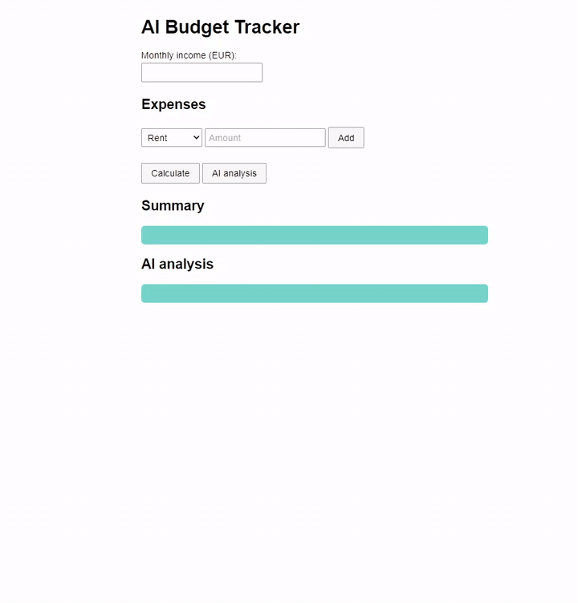
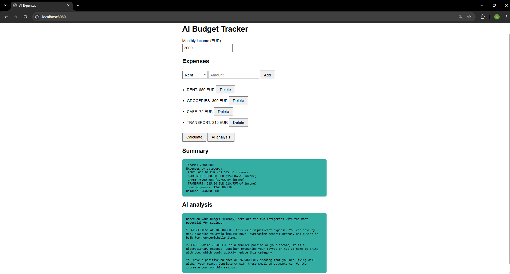
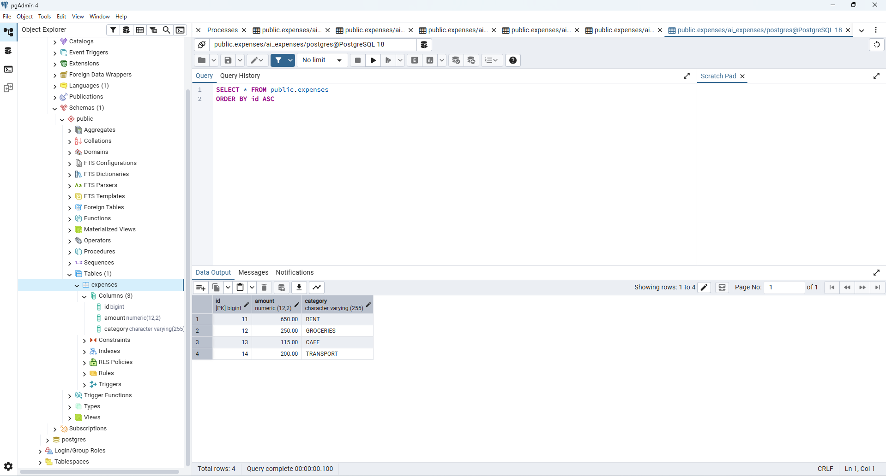

# AI Budget Tracker

[English](README.md) | Deutsch

Eine kleine Web-App, in der man sein monatliches Einkommen und seine Ausgaben einträgt und eine Zusammenfassung sowie ein paar Spartipps von einer KI bekommt.



## Was die App macht

Man trägt Ausgaben ein (Miete, Lebensmittel, Café, Transport), die in einer PostgreSQL-Datenbank gespeichert werden. Mit dem Einkommen berechnet die App die Summe, den Saldo und den Anteil jeder Kategorie am Einkommen. Danach liest Google Gemini diese Zusammenfassung und schlägt vor, wo man sparen könnte.

## Screenshot



## Warum ich das Projekt gemacht habe

Mein Ziel war es, etwas Besonderes zu entwickeln, das gleichzeitig verschiedene Bereiche der Programmierung abdeckt. Dadurch soll es einen besseren Überblick über meine Fähigkeiten geben.
## Eine Entscheidung, die mir wichtig ist

Die KI rechnet nichts. Java berechnet alles mit `BigDecimal` und gibt die fertige Zusammenfassung als Text an Gemini weiter. Die Anweisung sagt dem Modell, dass es nur diese Zahlen verwenden darf. So kann die KI keine Werte erfinden, und die Berechnung lässt sich testen.

## Technologien

Java 25, Spring Boot 4.1, Spring Data JPA, PostgreSQL, Maven, JUnit, Gemini-API. Die Seite selbst besteht aus normalem HTML, CSS und JavaScript.

## Aufbau

```
index.html  ->  Controller  ->  BudgetSummaryFormatter -> BudgetCalculator
                    |
                    +-->  ExpenseRepository  ->  PostgreSQL
                    +-->  GeminiClient       ->  Gemini-API
```

Die Ausgaben liegen in der Tabelle `expenses`:



Der Browser schickt JSON an die Controller. Die Controller laden die Ausgaben aus der Datenbank, lassen den Calculator rechnen und fragen Gemini nach der Erklärung. `Expense` prüft sich selbst (Betrag über null, höchstens zwei Nachkommastellen), deshalb gelangen ungültige Daten nicht in die Datenbank.

## Lokal starten

Man braucht JDK 25, Maven, PostgreSQL und einen Gemini-API-Schlüssel aus Google AI Studio.

1. Projekt klonen:
   ```
   git clone https://github.com/akhmetovkhaidar-glitch/ai-expenses.git
   cd ai-expenses
   ```
2. Datenbank anlegen:
   ```sql
   CREATE DATABASE ai_expenses;
   ```
   Die Tabelle wird beim ersten Start automatisch erstellt. Die Verbindungseinstellungen stehen in `src/main/resources/application.properties`.
3. Zwei Umgebungsvariablen setzen (die geheimen Daten liegen nicht im Repository):
   ```
   GEMINI_API_KEY=dein Schlüssel
   DB_PASSWORD=dein PostgreSQL-Passwort
   ```
4. App starten und http://localhost:8080 öffnen:
   ```
   mvn spring-boot:run
   ```

Ohne Gemini-Schlüssel startet die App trotzdem, nur die KI-Analyse schlägt fehl. Die Tests laufen mit `mvn test`.

## API

```
GET     /api/expenses         Ausgaben auflisten
POST    /api/expenses         hinzufügen, z. B. {"category": "RENT", "amount": 600}
DELETE  /api/expenses/{id}    löschen
POST    /api/summary          Body: {"income": 2000}
POST    /api/analysis         dasselbe, plus KI-Analyse
```

Kategorien: RENT, GROCERIES, CAFE, TRANSPORT. Ungültige Eingaben liefern Status 400 mit einer Fehlermeldung.

## Einschränkungen

- Es gibt keinen Login. Alle, die die App öffnen, sehen dieselben Ausgaben, daher ist sie für die lokale Nutzung gedacht.
- Das Einkommen wird nicht gespeichert, sondern nur für die Berechnung genutzt.
- Die Tabelle wird von Hibernate erstellt. In einem echten Projekt würde man Migrationen verwenden.
- Die Tipps der KI sind allgemeine Vorschläge, keine Finanzberatung.


## Autor

Haidar Akhmetov
