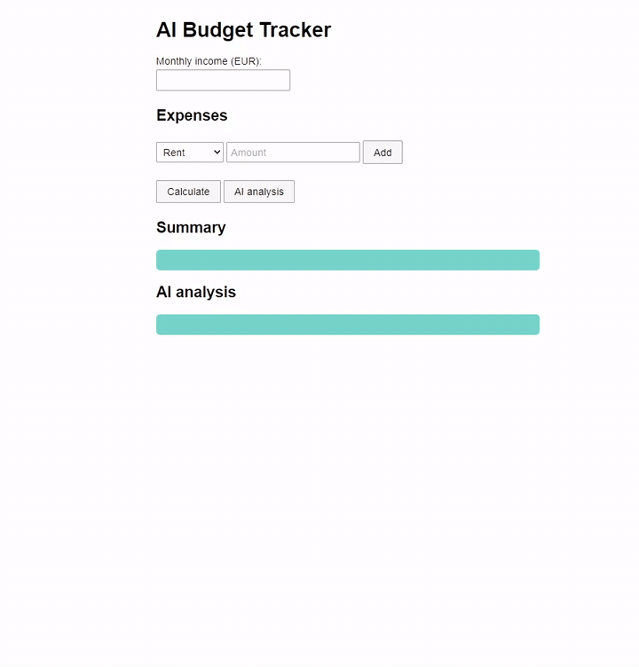
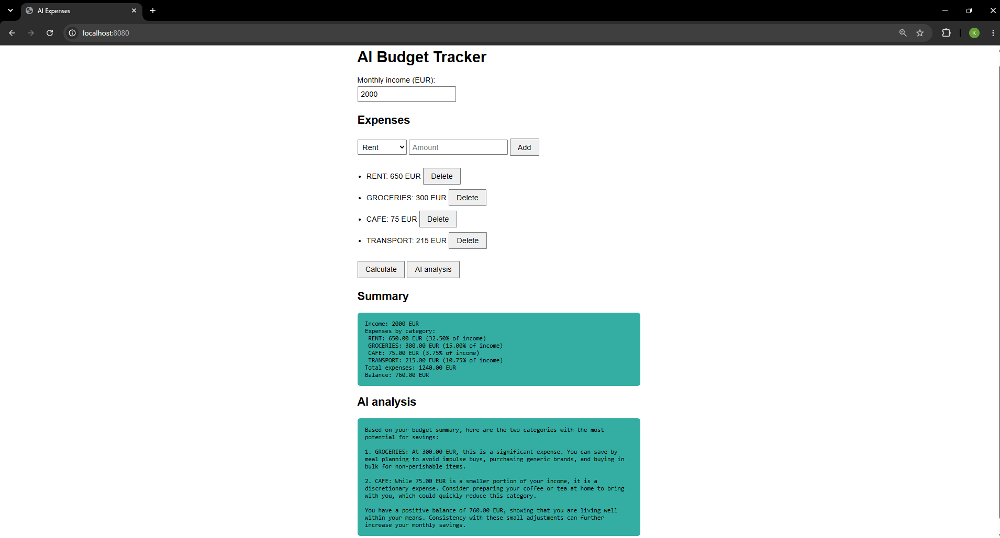
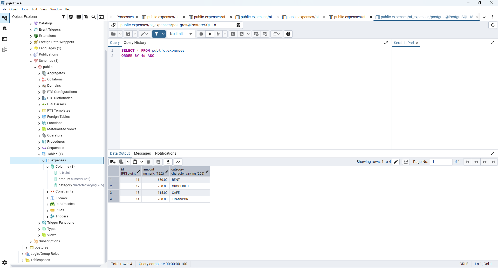

# AI Budget Tracker

English | [Deutsch](README.de.md)

A small web app where you enter your monthly income and your expenses, and get a summary plus a few saving tips from an AI.



## What it does

You add expenses (rent, groceries, cafe, transport) and they are saved in a PostgreSQL database. With your income, the app calculates the total, the balance and how much of your income each category takes. Then Google Gemini reads that summary and suggests where you could save.

## Screenshot



## Why I built it

My goal was to create something extraordinary which simultaneously covers different aspects of programming. Therefore, it should provide a better overview of my capabilities.

## One decision I care about

The AI does not calculate anything. Java calculates everything with `BigDecimal` and passes the finished summary to Gemini as text. The instruction tells the model to use only these numbers. This way the AI cannot invent figures, and the calculation can be tested.

## Technologies

Java 25, Spring Boot 4.1, Spring Data JPA, PostgreSQL, Maven, JUnit, Gemini API. The page itself is plain HTML, CSS and JavaScript.

## How it is structured

```
index.html  ->  Controller  ->  BudgetSummaryFormatter -> BudgetCalculator
                    |
                    +-->  ExpenseRepository  ->  PostgreSQL
                    +-->  GeminiClient       ->  Gemini API
```

The expenses are stored in the table `expenses`:



The browser sends JSON to the controllers. The controllers load expenses from the database, let the calculator do the math and ask Gemini for the explanation. `Expense` validates itself (amount above zero, at most two decimal places), so invalid data never reaches the database.

## Run it locally

You need JDK 25, Maven, PostgreSQL and a Gemini API key from Google AI Studio.

1. Clone the project:
   ```
   git clone https://github.com/akhmetovkhaidar-glitch/ai-expenses.git
   cd ai-expenses
   ```
2. Create the database:
   ```sql
   CREATE DATABASE ai_expenses;
   ```
   The table is created automatically on the first start. Connection settings are in `src/main/resources/application.properties`.
3. Set two environment variables (the secrets are not in the repository):
   ```
   GEMINI_API_KEY=your key
   DB_PASSWORD=your PostgreSQL password
   ```
4. Start the app and open http://localhost:8080:
   ```
   mvn spring-boot:run
   ```

Without a Gemini key the app still starts, only the AI analysis fails. Tests run with `mvn test`.

## API

```
GET     /api/expenses         list expenses
POST    /api/expenses         add one, e.g. {"category": "RENT", "amount": 600}
DELETE  /api/expenses/{id}    delete one
POST    /api/summary          body: {"income": 2000}
POST    /api/analysis         same, plus the AI analysis
```

Categories: RENT, GROCERIES, CAFE, TRANSPORT. Invalid input returns status 400 with an error message.

## Limits

- No login. Everyone who opens the app sees the same expenses, so it is meant for local use.
- Income is not saved, it is only used for the calculation.
- The table is created by Hibernate. A real project would use migrations.
- The AI tips are general suggestions, not financial advice.


## Author

Khaidar Akhmetov
